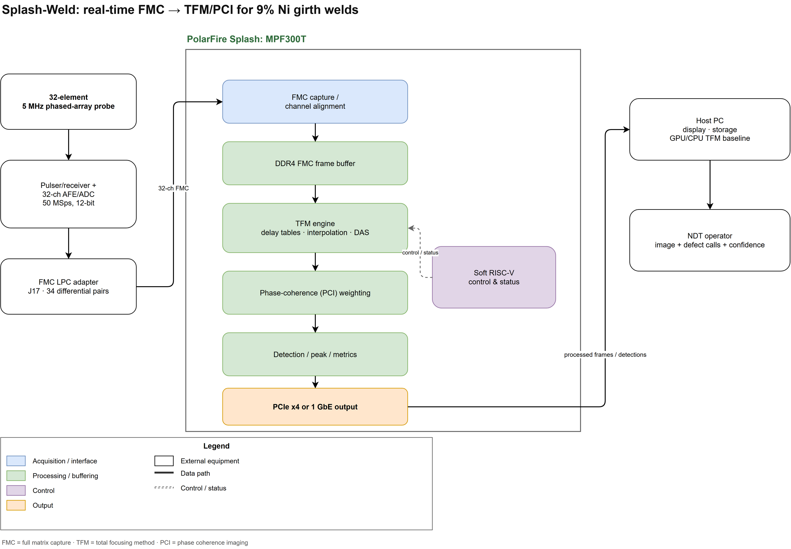

# Splash-Weld

Ultrasonic weld inspection using PolarFire Splash for full-matrix-capture (FMC) processing and coherence-weighted total focusing method (TFM) imaging.

Splash-Weld is a proposal-stage project for the PolarFire FPGA Design Contest 2026. The initial scope is one documented 9% Ni steel girth-weld specimen and one 32-element, 5 MHz probe. The project aims to reduce false calls while preserving planar-defect detection.

## Planned system

An external pulser/receiver and digitizer will capture raw ultrasonic channels. An FMC LPC adapter will connect the digitizer to Splash's J17 connector. The FPGA will align channels, buffer FMC frames in DDR4, reconstruct TFM images and apply phase-coherence weighting. Images and indications will stream to a host over PCIe or Gigabit Ethernet. A soft RISC-V core will provide control and status.

The host will display images, store captures and run the GPU/CPU reference pipeline. Planned comparisons against the reference and a compact FPGA cover image quality, throughput, latency, resources and power. A blinded specimen test will assess detection and sizing.

## System block diagram

- [View the diagram PDF](system-block-diagram.pdf).
- [Open the editable draw.io source](system-block-diagram.drawio) in [diagrams.net](https://app.diagrams.net/).

## Current status

This initial repository contains the project overview and system diagram. The probe, front end, digitizer, adapter and specimen are being requested through an equipment loan. The diagram describes the planned architecture. The first bench task is a known-echo and raw-FMC capture test.
